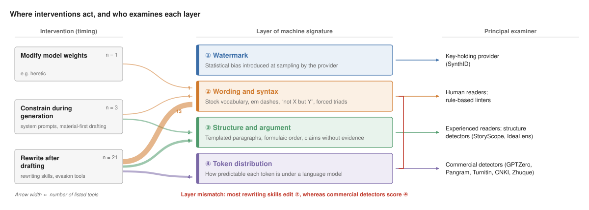

<!-- Generated by scripts/build_readme.py from data/ and templates/. Do not edit by hand. -->
# Awesome De-AI Writing

***This repository collects 21 de-AI writing skills with more than 1,000 GitHub stars.***

[中文版](README_zh.md) · 37 entries · star counts as of 2026-11-22, refreshed weekly

> Large language models (LLMs) now contribute to a substantial fraction of the scientific literature[1](#ref-1),[2](#ref-2), and an ecosystem of "humanizer" skills has emerged to make such text read as if written by a person. These tools are usually compared by popularity or by anecdote. Here we classify them instead by the layer of the text they modify — the generation-time watermark, surface wording, discourse structure or the token-probability distribution — and argue that this distinction largely accounts for their observed behaviour. Most widely adopted skills act on wording, whereas commercial detectors respond chiefly to token-level predictability; accordingly, a rewrite that reads as natural to a human may still be scored as fully machine-generated. We catalogue 37 tools and resources against this taxonomy, summarize the evidence on detection and its limits, and outline principles for responsible use.

**Fig. 1 | A layer-based view of de-AI writing tools.** **a**, Four layers at which text can carry a machine signature (centre), the interventions that act on them, grouped by timing (left), and the principal examiner of each layer (right). Curve width is proportional to the number of listed tools acting on a given layer; tools that act on two layers contribute to both. The red bracket marks the mismatch between where most rewriting skills operate (②) and what commercial detectors measure (④). **b**, Number of listed tools per layer, stacked by timing, with the summed GitHub stars of those tools. Watermarking toolkits carry no timing. Detectors, benchmarks and adjacent writing suites are excluded. Panels **a** and **b** are regenerated from `data/entries.yaml` and `data/stars.json` at each build.

## Key points

- "AI-ness" in text is not a single property. It arises at four separable layers, each examined by different readers or detectors.
- The majority of popular de-AI skills operate on wording and syntax (layer ②), the layer most visible to human readers but least relevant to probability-based detectors (layer ④).
- Detection itself is unreliable at the margins: detectors misclassify non-native English writing[3](#ref-3), and adversarial paraphrasing degrades both detector recall and watermark detection[4](#ref-4).
- Emerging detectors that read narrative and argument structure[5](#ref-5),[6](#ref-6) suggest that surface-level rewriting will become less effective over time.
- These tools are appropriate for improving clarity, not for concealing AI involvement; disclosure obligations apply irrespective of any detector score[10](#ref-10),[11](#ref-11).

## Contents

- [Introduction](#introduction)
- [A four-layer taxonomy](#a-four-layer-taxonomy)
- [Selecting a tool by use case](#selecting-a-tool-by-use-case)
- [Catalogue](#catalogue)
- [Evidence on prevalence, detection and watermarking](#evidence-on-prevalence-detection-and-watermarking)
- [News and editorial policy](#news-and-editorial-policy)
- [Outlook and open questions](#outlook-and-open-questions)
- [Responsible use](#responsible-use)
- [References](#references)
- [Contributing](#contributing)

## Introduction

Analyses of excess vocabulary estimate that at least 13.5% of PubMed abstracts published in 2024 were processed with an LLM[1](#ref-1), and that up to 22.5% of sentences in computer-science abstracts had been LLM-modified by September 2024[2](#ref-2). In parallel, open-source "humanizer" skills for coding agents have accumulated tens of thousands of GitHub stars, and their use in academic writing has attracted coverage in *Nature*[12](#ref-12).

A recurring observation among users is that a rewrite judged clean by a human reader may still be scored as 100% AI-generated. We argue that this apparent paradox reflects a mismatch of layers: most skills edit word choice and punctuation, whereas commercial detectors primarily estimate how predictable each token is under a language model. Classifying tools by the layer on which they act therefore indicates, before installation, what a given tool can and cannot be expected to change.

**Inclusion criteria.** Tools are included if they have at least 1,000 GitHub stars. Watermarking and detection code accompanying a peer-reviewed publication is included regardless of star count and marked 📄. Tools marketed primarily for evading detectors are listed for completeness, marked ⚠️, and not endorsed.

## A four-layer taxonomy

**Table 1 | Layers at which text can carry a machine signature.**

| Layer | Definition | Principal examiner | Amenable to a rewriting skill? |
|---|---|---|---|
| ① Watermark | A statistical signal embedded by the provider during generation | The key-holding provider (for example, SynthID[8](#ref-8)) | Removable by extensive paraphrasing, at a measurable cost to quality[4](#ref-4) |
| ② Wording and syntax | Stock vocabulary, em dashes, "not X but Y" constructions, forced triads, filler | Human readers; rule-based linters | Yes; almost all widely used skills act here |
| ③ Structure and argument | Templated paragraphs, formulaic argument order, over-explained themes, claims unsupported by evidence | Experienced readers; structure-level detectors[5](#ref-5),[6](#ref-6) | Partially; a minority of skills attempt it |
| ④ Token distribution | The extent to which each token is the most probable continuation | GPTZero, Pangram, Turnitin, CNKI, Tencent Zhuque | Rarely, because the rewriter is itself an LLM |

A second, orthogonal axis is **timing**. Most tools rewrite text after it has been drafted (post hoc); a few constrain the text during generation, through system prompts or material-first drafting; and one modifies the model weights directly.

## Selecting a tool by use case

- **English manuscripts and grant proposals.** [academic-humanizer](https://github.com/AIScientists-Dev/academic-humanizer) preserves every number and citation and checks that verbs do not overstate the evidence. [stop-slop](https://github.com/hardikpandya/stop-slop) is not recommended for scientific text, because it prohibits the passive voice.
- **General English prose.** [humanizer](https://github.com/blader/humanizer).
- **Chinese.** [Humanizer-zh](https://github.com/op7418/Humanizer-zh) for a comprehensive pass; [说人话](https://github.com/MrGeDiao/shuorenhua) for minimal intervention; [lieflat-less-ai-tone](https://github.com/larashero3-dotcom/lieflat-less-ai-tone) when a metric-based diagnostic report is wanted before rewriting.
- **Fiction and narrative.** [sepia](https://github.com/Nanako0129/sepia).
- **Prevention rather than correction.** [talk-normal](https://github.com/hexiecs/talk-normal) and [human-writing](https://github.com/KKKKhazix/human-writing).

## Catalogue

Within each table, entries are ordered by GitHub stars.

### Layer ② Wording and syntax: pattern-based editors

| Repo | ⭐ | Lang | Use | When | What it does |
|---|---|---|---|---|---|
| [blader/humanizer](https://github.com/blader/humanizer) | 72.3k | EN | general | rewrite after | Rewrites against 26 patterns drawn from Wikipedia's "Signs of AI writing" while retaining all factual content; the authors acknowledge that detectors still flag most outputs. |
| [op7418/Humanizer-zh](https://github.com/op7418/Humanizer-zh) | 23.6k | 中文 | general | rewrite after | Chinese adaptation of humanizer; rules revised in September 2026 to stop over-correcting ordinary parallelism and dashes. |
| [hardikpandya/stop-slop](https://github.com/hardikpandya/stop-slop) | 19.1k | EN | general | rewrite after | Applies the strictest rule set in its category (no adverbs, no passive voice, pairs instead of triads) with a five-dimension self-assessment; ill-suited to scientific prose. |
| [petergyang/no-ai-slop](https://github.com/petergyang/no-ai-slop) | 13.7k | EN | general | rewrite after | Lightweight checklist of more than 20 slop patterns. |
| [epoko77-ai/im-not-ai](https://github.com/epoko77-ai/im-not-ai) | 6.7k | 한국어 | general | rewrite after | Korean-language editor targeting translationese, mechanical parallelism and more than 70 other markers. |
| [conorbronsdon/avoid-ai-writing](https://github.com/conorbronsdon/avoid-ai-writing) | 6.0k | EN | general | rewrite after | Offers rewrite, detect and in-place edit modes, and ships a deterministic rule-based detector (npm) that scores text from 0 to 100. |
| [MrGeDiao/shuorenhua](https://github.com/MrGeDiao/shuorenhua) | 2.7k | 中文 EN | general | rewrite after | The most conservative editor listed: removes filler by default and tones down promotional language only on explicit request. |
| [ItsssssJack/SlopMonster](https://github.com/ItsssssJack/SlopMonster) | 1.3k | EN | general, social | rewrite after | Lints for markers, rewrites with a second model, then lints again. |
| [hylarucoder/ai-flavor-remover](https://github.com/hylarucoder/ai-flavor-remover) | 1.2k | 中文 | general | rewrite after | Prompt-based remover for Chinese text; the author reports testing on Gemini 2.5 Pro only. |
| [theclaymethod/unslop](https://github.com/theclaymethod/unslop) | 1.2k | EN | general | rewrite after | General-purpose agent skill for removing AI markers from prose. |
| [Raymondhou0917/speak-human-tw](https://github.com/Raymondhou0917/speak-human-tw) | 1.2k | 繁中 | general | rewrite after | Traditional Chinese editor covering 38 markers, with corrections to regional usage and punctuation. |
| [textlint-ja/textlint-rule-preset-ai-writing](https://github.com/textlint-ja/textlint-rule-preset-ai-writing) | 1.2k | 日本語 | general, tech docs | rewrite after | Japanese textlint preset that flags AI-style phrasing with a deterministic linter rather than an LLM. |

### Layers ②–③ Corpus-calibrated editors

| Repo | ⭐ | Lang | Use | When | What it does |
|---|---|---|---|---|---|
| [larashero3-dotcom/lieflat-less-ai-tone](https://github.com/larashero3-dotcom/lieflat-less-ai-tone) | 8.6k | 中文 | general | rewrite after | Selects edit targets from a corpus study (1,169 texts, ~5.2 million characters, >100 metrics); produces a diagnostic report, then rewrites and re-measures. |

### Layer ③ Structure and argument

| Repo | ⭐ | Lang | Use | When | What it does |
|---|---|---|---|---|---|
| [Adkid-Zephyr/anti-defensive-writing-Skill](https://github.com/Adkid-Zephyr/anti-defensive-writing-Skill) | 7.0k | 中文 EN | academic | rewrite after | Reframes a paper as a "press conference", altering narrative strategy rather than AI markers; may remove unfavourable results. |
| [AIScientists-Dev/academic-humanizer](https://github.com/AIScientists-Dev/academic-humanizer) | 5.9k | EN | academic | rewrite after | Targets manuscripts and NSF/NIH proposals; checks that each claim is backed by a number or citation and that no verb overstates the evidence. Covered by Nature news (July 2026). |
| [KKKKhazix/human-writing](https://github.com/KKKKhazix/human-writing) | 4.7k | 中文 | general, social | while writing | Inventories source material before drafting, asks rather than invents when information is missing, and requires each paragraph to contribute new content. |
| [Nanako0129/sepia](https://github.com/Nanako0129/sepia) | 3.9k | EN 中文 | fiction, tech docs | rewrite after | Repairs narrative architecture before word choice, citing StoryScope; applies venue-specific rules to professional documents. |
| [Kiterlin/anti-defensive-writing](https://github.com/Kiterlin/anti-defensive-writing) | 2.3k | EN | academic | rewrite after | Codex skill implementing the same anti-defensive-writing approach. |

### Upstream approaches: prevention during generation or in the model

| Repo | ⭐ | Lang | Use | When | What it does |
|---|---|---|---|---|---|
| [p-e-w/heretic](https://github.com/p-e-w/heretic) | 42.6k | — | general | model weights | Training-free modification of open-model weights that suppresses slop and sycophancy; acts on the generator rather than the text. |
| [larashero3-dotcom/writing-dna-skill](https://github.com/larashero3-dotcom/writing-dna-skill) | 3.3k | 中文 | general | while writing | Distils an author's style into a reusable skill (style imitation). |
| [hexiecs/talk-normal](https://github.com/hexiecs/talk-normal) | 1.9k | EN | general | while writing | System prompt that prevents a model from producing slop in the first place. |

### Layer ④ Detector-evasion tools ⚠️

The efficacy claims below are made by the authors and have not been independently verified. The DAMAGE study found that all 19 humanizers it audited degraded text quality[4](#ref-4). Submitting evasion-processed text as one's own work may contravene academic-integrity policies.

| Repo | ⭐ | Lang | Use | When | What it does |
|---|---|---|---|---|---|
| [AhmadHassan-BTed/Turnitout-Humanizer](https://github.com/AhmadHassan-BTed/Turnitout-Humanizer) ⚠️ | 12.5k | EN | academic | rewrite after | Claims programmatic evasion of Turnitin, iThenticate and GPTZero ("similarity evader"); unverified. |
| [lynote-ai/humanize-text](https://github.com/lynote-ai/humanize-text) | 3.5k | EN | general | rewrite after | Combines LLM rewriting with multi-engine round-trip translation. |
| [iniwap/AIWriteX](https://github.com/iniwap/AIWriteX) ⚠️ | 2.3k | 中文 | social | rewrite after | Automated WeChat article pipeline advertised as passing Tencent Zhuque detection. |
| [chi111i/BypassAIGC](https://github.com/chi111i/BypassAIGC) ⚠️ | 2.3k | 中文 | academic | rewrite after | Thesis-polishing application marketed as lowering AIGC scores, illustrated with GPTZero before-and-after comparisons. |

### Layer ① Watermarking

No text-watermark removal tool currently exceeds 1,000 stars, in part because paraphrasing alone suffices to remove text watermarks[4](#ref-4).

| Repo | ⭐ | What it is |
|---|---|---|
| [wiltodelta/remove-ai-watermarks](https://github.com/wiltodelta/remove-ai-watermarks) | 6.5k | Removes watermarks and provenance metadata from images, video and audio (not text). |
| [aloshdenny/reverse-SynthID](https://github.com/aloshdenny/reverse-SynthID) | 5.1k | Reverse engineering of Gemini's SynthID detection. |
| [google-deepmind/synthid-text](https://github.com/google-deepmind/synthid-text) | 1.3k | Reference implementation of SynthID-Text (Dathathri et al., Nature 2024). |
| [THU-BPM/MarkLLM](https://github.com/THU-BPM/MarkLLM) | 1.1k | Open-source toolkit of LLM watermarking algorithms (EMNLP 2024 demo). |
| [jwkirchenbauer/lm-watermarking](https://github.com/jwkirchenbauer/lm-watermarking) 📄 | 711 | Code for "A Watermark for Large Language Models" (Kirchenbauer et al., ICML 2023). |

### Open-source detectors and benchmarks

| Repo | ⭐ | What it is |
|---|---|---|
| [openai/gpt-2-output-dataset](https://github.com/openai/gpt-2-output-dataset) | 2.0k | GPT-2 outputs released by OpenAI to support detection research. |
| [Hello-SimpleAI/chatgpt-comparison-detection](https://github.com/Hello-SimpleAI/chatgpt-comparison-detection) | 1.5k | HC3 human-versus-ChatGPT corpus with RoBERTa detectors trained on 2023 ChatGPT responses. |
| [HendrikStrobelt/detecting-fake-text](https://github.com/HendrikStrobelt/detecting-fake-text) 📄 | 503 | GLTR, a visual token-rank tool that preceded perplexity-based detection. |
| [eric-mitchell/detect-gpt](https://github.com/eric-mitchell/detect-gpt) 📄 | 482 | DetectGPT: zero-shot detection via probability curvature (ICML 2023). |
| [baoguangsheng/fast-detect-gpt](https://github.com/baoguangsheng/fast-detect-gpt) 📄 | 444 | Fast-DetectGPT: detection via conditional probability curvature (ICLR 2024). |
| [ahans30/Binoculars](https://github.com/ahans30/Binoculars) 📄 | 439 | Binoculars: zero-shot detection from the perplexity ratio of two models (ICML 2024). |
| [liamdugan/raid](https://github.com/liamdugan/raid) 📄 | 227 | RAID: the largest detection benchmark, including adversarial attacks (ACL 2024). |
| [vivek3141/ghostbuster](https://github.com/vivek3141/ghostbuster) 📄 | 184 | Ghostbuster: detection from weak language-model features (NAACL 2024). |

### Related writing suites with a de-AI step

| Repo | ⭐ | Lang | Use | When | What it does |
|---|---|---|---|---|---|
| [binary-husky/gpt_academic](https://github.com/binary-husky/gpt_academic) | 71.7k | 中文 EN | academic |  | Long-established interface for academic polishing, translation and writing. |
| [Imbad0202/academic-research-skills](https://github.com/Imbad0202/academic-research-skills) | 58.1k | EN | academic |  | Claude Code skill suite covering research, writing, review, revision and finalization. |
| [zenstory-ai/oh-story-claudecode](https://github.com/zenstory-ai/oh-story-claudecode) | 8.8k | 中文 | fiction |  | Web-novel skill suite that includes a de-AI step. |
| [Master-cai/Research-Paper-Writing-Skills](https://github.com/Master-cai/Research-Paper-Writing-Skills) | 8.5k | 中文 EN | academic |  | ML, CV and NLP paper-writing skills adapted from Sida Peng's public notes. |
| [EthanYoQ/Pagekin](https://github.com/EthanYoQ/Pagekin) | 2.8k | 中文 | fiction |  | Novel-writing application that can import de-AI skills. |
| [Fenng/Tech-Doc-Style-Chinese](https://github.com/Fenng/Tech-Doc-Style-Chinese) | 1.6k | 中文 | tech docs |  | Style skill for Chinese technical documentation and product copy. |

## Evidence on prevalence, detection and watermarking

**Prevalence in the scientific literature.** Excess-vocabulary analysis indicates that at least 13.5% of 2024 PubMed abstracts were processed with an LLM[1](#ref-1) (code: [berenslab/llm-excess-vocab](https://github.com/berenslab/llm-excess-vocab)). A distributional estimate found that 22.5% of sentences in computer-science abstracts had been LLM-modified by September 2024[2](#ref-2).

**Detection and its limitations.** Seven widely used detectors classified more than half of a set of TOEFL essays written by non-native English speakers as AI-generated[3](#ref-3). In the DAMAGE audit, humanizer rewriting reduced GPTZero recall from 99.73% to 60.04%, and DIPPER paraphrasing reduced SynthID detection from 87.6% to 5.4%[4](#ref-4). Conversely, structure-level methods appear more robust to surface editing: narrative-structure features alone identified AI-generated fiction with a macro-F1 of 93.2%, even after human editors had rewritten the prose style[5](#ref-5), and IdeaLens detects AI text from concepts and argument structure rather than wording[6](#ref-6). In peer review, Pangram estimated that approximately 21% of ICLR 2026 reviews were fully AI-generated[7](#ref-7).

**Watermarking.** SynthID-Text embeds a tournament-sampling watermark at generation time and has been deployed at production scale[8](#ref-8); the earlier green-list scheme of Kirchenbauer et al. partitions the vocabulary at each step and biases sampling towards a pseudorandom subset[9](#ref-9).

## News and editorial policy

- *Nature* news, July 2026. ['Humanizer' tool can erase signs of AI-written text — alarming scientists](https://www.nature.com/articles/d41586-026-02105-3)[12](#ref-12).
- *The Register*, 8 July 2026. [Tool promises to make lazy academics' AI-written papers sound more human](https://www.theregister.com/a/5268460).
- *TechCrunch*, 20 November 2025. [The best guide to spotting AI writing comes from Wikipedia](https://techcrunch.com/2025/11/20/the-best-guide-to-spotting-ai-writing-comes-from-wikipedia/); source guide: [Wikipedia: Signs of AI writing](https://en.wikipedia.org/wiki/Wikipedia:Signs_of_AI_writing).
- *36Kr*, May 2026. [论文 AI 检测，正在逼疯这届大学生](https://www.36kr.com/p/3823851041476992). A canonical modern Chinese essay was scored as 62.88% AI-generated.
- CCTV, via Guangming Online, 22 May 2026. [毕业论文将检测AIGC率，检测标准科学吗？](https://m.gmw.cn/2026-05/22/content_1304466247.htm) Chinese universities apply AIGC thresholds of 15–40%.
- **Editorial policies.** Nature Portfolio permits AI-assisted language editing but requires disclosure of more extensive writing support[10](#ref-10); the *Science* journals require disclosure of the tool, its version and the full prompt[11](#ref-11).

## Outlook and open questions

Three questions remain open. First, no tool in this catalogue has been shown to change layer-④ scores while preserving content; whether any LLM-based rewriter can do so is unresolved, given that the rewriter's own output distribution is what detectors measure. Second, as structure-level detectors mature[5](#ref-5),[6](#ref-6), the advantage conferred by layer-② editing is likely to diminish, shifting attention to argument and evidence. Third, the false-positive rates documented for non-native writers[3](#ref-3) and for canonical human texts call into question the use of fixed detector thresholds in assessment. Systematic benchmarks spanning multiple texts, languages and detectors would help to address all three questions.

## Responsible use

These tools should be used to make one's own writing clearer, not to conceal the involvement of AI. Every number and claim should be verified after rewriting, because some skills omit facts or strengthen claims beyond the evidence. Authors should follow the disclosure requirements of the relevant journal, funder or institution irrespective of any detector result.

## References

1. Kobak, D., González-Márquez, R., Horvát, E.-Á. & Lause, J. Delving into LLM-assisted writing in biomedical publications through excess vocabulary. *Sci. Adv.* **11**, eadt3813 (2025). [doi:10.1126/sciadv.adt3813](https://doi.org/10.1126/sciadv.adt3813) · [arXiv](https://arxiv.org/abs/2406.07016)
   - *Estimates a lower bound on LLM processing across PubMed from shifts in word frequency.*
2. Liang, W. et al. Quantifying large language model usage in scientific papers. *Nat. Hum. Behav.* (2025). [doi:10.1038/s41562-025-02273-8](https://doi.org/10.1038/s41562-025-02273-8) · [PDF](https://nlp.stanford.edu/~manning/papers/Liang_et_al-2025-Nature_Human_Behaviour.pdf)
3. Liang, W., Yuksekgonul, M., Mao, Y., Wu, E. & Zou, J. GPT detectors are biased against non-native English writers. *Patterns* **4**, 100779 (2023). [doi:10.1016/j.patter.2023.100779](https://doi.org/10.1016/j.patter.2023.100779)
   - *Documents systematic false positives against non-native writers.*
4. Masrour, E., Emi, B. & Spero, M. DAMAGE: detecting adversarially modified AI generated text. Preprint at [arXiv:2501.03437](https://arxiv.org/abs/2501.03437) (2025).
   - *The most direct audit of humanizers to date: quality degradation, detector recall and watermark removal.*
5. Russell et al. StoryScope. Preprint at [arXiv:2604.03136](https://arxiv.org/abs/2604.03136) (2026).
6. IdeaLens (University of Maryland). Preprint at [arXiv:2610.06778](https://arxiv.org/abs/2610.06778) (2026).
7. Estimate of AI-generated ICLR 2026 reviews by Pangram, as reported by *Nature* news and cited in [arXiv:2602.00319](https://arxiv.org/abs/2602.00319) (2026).
8. Dathathri, S. et al. Scalable watermarking for identifying large language model outputs. *Nature* **634**, 818–823 (2024). [doi:10.1038/s41586-024-08025-4](https://doi.org/10.1038/s41586-024-08025-4) · [PMC](https://www.ncbi.nlm.nih.gov/pmc/articles/PMC11499265/)
9. Kirchenbauer, J. et al. A watermark for large language models. In *Proc. 40th International Conference on Machine Learning* (ICML, 2023). [Code](https://github.com/jwkirchenbauer/lm-watermarking)
10. Nature Portfolio. Artificial intelligence (AI). Editorial policies. <https://www.nature.com/nature-portfolio/editorial-policies/ai>
11. *Science* journals' policy on AI disclosure, as reported by *Times Higher Education*. <https://www.timeshighereducation.com/node/729880>
12. 'Humanizer' tool can erase signs of AI-written text — alarming scientists. *Nature* (news, July 2026). <https://www.nature.com/articles/d41586-026-02105-3>

## Contributing

To add or correct an entry, edit [data/entries.yaml](data/entries.yaml), run `python scripts/build_readme.py` and open a pull request. Inclusion criteria and guidance on assigning a layer are given in [CONTRIBUTING.md](CONTRIBUTING.md).

## License

[CC0 1.0](LICENSE). Linked projects retain their own licences.
