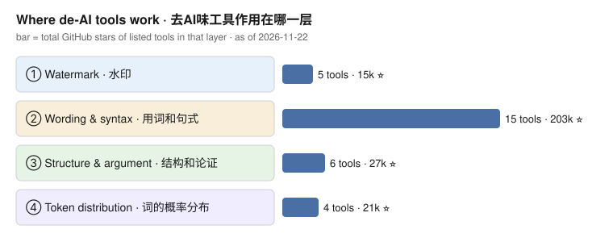

<!-- Generated by scripts/build_readme.py from data/ and templates/. Do not edit by hand. -->
# Awesome De-AI Writing｜去AI味工具综述

一份综述式合集：收录让 AI 辅助写作读起来不那么像 AI 的 Skill、工具、检测器和研究。按**原理**分类（工具作用在「AI 味」的哪一层），用途做标签。

[English](README.md) · 共 37 项 · 星数截至 2026-11-22，每周自动更新

## 目录

- [为什么按原理分类](#为什么按原理分类)
- [四层分类法](#四层分类法)
- [按场景速查](#按场景速查)
- [合集](#合集)
- [研究文献](#研究文献)
- [新闻与政策](#新闻与政策)
- [使用原则](#使用原则)
- [参与贡献](#参与贡献)

## 为什么按原理分类

高赞的 humanizer 类 Skill 大多在改用词和标点，而商业检测器主要测的是另一件事：每个词是不是「最好猜」的那个。两者错位，所以常见这种情况：读者觉得改得很干净，检测器照样判 100% AI。按作用层分类，装之前就能知道一个工具能做什么、做不到什么。

**收录标准**：工具需 GitHub 1,000 星以上；有同行评审论文的水印和检测代码不限星数，标 📄；以绕过检测为卖点的工具为完整起见列出，标 ⚠️。

## 四层分类法

| 层 | 是什么 | 谁在查 | Skill 能不能改 |
|---|---|---|---|
| ① 水印 | 模型生成时埋进去的统计信号 | 持有密钥的厂商（如 SynthID） | 大幅改写能洗掉，但会牺牲文字质量 |
| ② 用词和句式 | 套话、破折号、「不是…而是…」、硬凑三段式 | 读者、规则检测器 | 能，几乎所有高赞 Skill 都在这一层 |
| ③ 结构和论证 | 段落套路、论证顺序、把主题讲透替读者总结、主张没有证据 | 有经验的读者、IdeaLens 等结构级检测器 | 部分能，少数 Skill 在尝试 |
| ④ 词的概率分布 | 每个词是不是最可预测的那个 | GPTZero、Pangram、Turnitin、知网、朱雀 | 基本不能，因为改写的还是 AI |

第二条轴是**时机**：大多数工具写完再改；少数在写的时候就规避（系统提示词、先清点材料再写）；还有一个直接改模型权重。

## 按场景速查

- **英文论文和基金**：[academic-humanizer](https://github.com/AIScientists-Dev/academic-humanizer)，数字和引用一个不改，还检查动词是否强于证据。科研文本别用 [stop-slop](https://github.com/hardikpandya/stop-slop)：它禁被动语态，「三项改两项」的规则还可能删掉列举项。
- **通用英文**：[humanizer](https://github.com/blader/humanizer)。
- **中文**：全面改用 [Humanizer-zh](https://github.com/op7418/Humanizer-zh)；只想轻改用 [说人话](https://github.com/MrGeDiao/shuorenhua)；想先看量化报告用 [lieflat-less-ai-tone](https://github.com/larashero3-dotcom/lieflat-less-ai-tone)。
- **小说和叙事**：[sepia](https://github.com/Nanako0129/sepia)。
- **从源头避免**：[talk-normal](https://github.com/hexiecs/talk-normal)、[human-writing](https://github.com/KKKKhazix/human-writing)。

## 合集

### 第②层 用词和句式：规则清单派

| Repo | ⭐ | 语言 | 用途 | 时机 | 做法 |
|---|---|---|---|---|---|
| [blader/humanizer](https://github.com/blader/humanizer) | 72.3k | EN | 通用 | 写完再改 | 基于 Wikipedia「Signs of AI writing」的 26 种模式，保留全部事实；README 明说检测器仍会标出大多数输出。 |
| [op7418/Humanizer-zh](https://github.com/op7418/Humanizer-zh) | 23.6k | 中文 | 通用 | 写完再改 | humanizer 中文版；2026-09 重写规则，普通排比、破折号不再一律修改。 |
| [hardikpandya/stop-slop](https://github.com/hardikpandya/stop-slop) | 19.1k | EN | 通用 | 写完再改 | 规则最硬（禁副词、禁被动、三项改两项），附 5 维自评分；用在论文上会误伤。 |
| [petergyang/no-ai-slop](https://github.com/petergyang/no-ai-slop) | 13.7k | EN | 通用 | 写完再改 | 轻量清单，20+ 种 slop 模式。 |
| [epoko77-ai/im-not-ai](https://github.com/epoko77-ai/im-not-ai) | 6.7k | 한국어 | 通用 | 写完再改 | 韩语；翻译腔、机械排比等 70+ 种痕迹。 |
| [conorbronsdon/avoid-ai-writing](https://github.com/conorbronsdon/avoid-ai-writing) | 6.0k | EN | 通用 | 写完再改 | 改写/检测/原地编辑三模式；自带 npm 规则检测器，0–100 打分。 |
| [MrGeDiao/shuorenhua](https://github.com/MrGeDiao/shuorenhua) | 2.7k | 中文 EN | 通用 | 写完再改 | 最保守：默认只删套话和提示语，宣传词要明确说「写平实点」才降调。 |
| [ItsssssJack/SlopMonster](https://github.com/ItsssssJack/SlopMonster) | 1.3k | EN | 通用, 社媒 | 写完再改 | 先 lint，再换一个模型清洗，再 lint。 |
| [hylarucoder/ai-flavor-remover](https://github.com/hylarucoder/ai-flavor-remover) | 1.2k | 中文 | 通用 | 写完再改 | 中文 AI 味去除；作者注明只在 Gemini 2.5 Pro 上测过。 |
| [theclaymethod/unslop](https://github.com/theclaymethod/unslop) | 1.2k | EN | 通用 | 写完再改 | 通用 de-AI 写作 Skill。 |
| [Raymondhou0917/speak-human-tw](https://github.com/Raymondhou0917/speak-human-tw) | 1.2k | 繁中 | 通用 | 写完再改 | 繁体中文；38 种痕迹，顺带校正用语与半形标点。 |
| [textlint-ja/textlint-rule-preset-ai-writing](https://github.com/textlint-ja/textlint-rule-preset-ai-writing) | 1.2k | 日本語 | 通用, 技术文档 | 写完再改 | 日语 textlint 规则集，用 lint 而非 LLM 标出 AI 腔。 |

### 第②→③层 数据校准派

| Repo | ⭐ | 语言 | 用途 | 时机 | 做法 |
|---|---|---|---|---|---|
| [larashero3-dotcom/lieflat-less-ai-tone](https://github.com/larashero3-dotcom/lieflat-less-ai-tone) | 8.6k | 中文 | 通用 | 写完再改 | 先用语料研究（1,169 篇、约 520 万字、100+ 指标）决定改什么；先出报告，再改写复测。 |

### 第③层 结构和论证

| Repo | ⭐ | 语言 | 用途 | 时机 | 做法 |
|---|---|---|---|---|---|
| [Adkid-Zephyr/anti-defensive-writing-Skill](https://github.com/Adkid-Zephyr/anti-defensive-writing-Skill) | 7.0k | 中文 EN | 科研 | 写完再改 | 把论文当「发布会」；改的是叙事策略而非 AI 痕迹，规则倾向删掉不利结果。 |
| [AIScientists-Dev/academic-humanizer](https://github.com/AIScientists-Dev/academic-humanizer) | 5.9k | EN | 科研 | 写完再改 | 面向论文和 NSF/NIH 基金；检查每个主张是否有数字/引用、动词是否强于证据。2026-07 Nature 新闻报道。 |
| [KKKKhazix/human-writing](https://github.com/KKKKhazix/human-writing) | 4.7k | 中文 | 通用, 社媒 | 写时规避 | 动笔前先清点材料，缺了就问不编；每段必须带来新信息。 |
| [Nanako0129/sepia](https://github.com/Nanako0129/sepia) | 3.9k | EN 中文 | 小说, 技术文档 | 写完再改 | 先修叙事结构再动用词（引 StoryScope 研究）；专业文档按场景分规则。 |
| [Kiterlin/anti-defensive-writing](https://github.com/Kiterlin/anti-defensive-writing) | 2.3k | EN | 科研 | 写完再改 | 同主题的 Codex Skill。 |

### 源头派：写时规避或改模型

| Repo | ⭐ | 语言 | 用途 | 时机 | 做法 |
|---|---|---|---|---|---|
| [p-e-w/heretic](https://github.com/p-e-w/heretic) | 42.6k | — | 通用 | 改模型 | 免训练修改开源模型权重，抑制 slop 与讨好倾向；改的是模型而不是文本。 |
| [larashero3-dotcom/writing-dna-skill](https://github.com/larashero3-dotcom/writing-dna-skill) | 3.3k | 中文 | 通用 | 写时规避 | 把任意作者的文风蒸馏成可复用 Skill（风格模仿）。 |
| [hexiecs/talk-normal](https://github.com/hexiecs/talk-normal) | 1.9k | EN | 通用 | 写时规避 | 一段系统提示词，让模型一开始就不写成 AI 腔。 |

### 第④层 降 AIGC / 绕检测工具 ⚠️

以下效果均为作者自述、未经验证。Pangram 的 DAMAGE 研究审查了 19 个 humanizer，全部会降低文字质量。把这类工具处理过的文本当作自己的成果提交，可能违反学术诚信规定。

| Repo | ⭐ | 语言 | 用途 | 时机 | 做法 |
|---|---|---|---|---|---|
| [AhmadHassan-BTed/Turnitout-Humanizer](https://github.com/AhmadHassan-BTed/Turnitout-Humanizer) ⚠️ | 12.5k | EN | 科研 | 写完再改 | 宣称程序化绕过 Turnitin、iThenticate、GPTZero；未经验证。 |
| [lynote-ai/humanize-text](https://github.com/lynote-ai/humanize-text) | 3.5k | EN | 通用 | 写完再改 | LLM 改写 + 多引擎回译。 |
| [iniwap/AIWriteX](https://github.com/iniwap/AIWriteX) ⚠️ | 2.3k | 中文 | 社媒 | 写完再改 | 公众号全自动写作，宣称「过朱雀检测」。 |
| [chi111i/BypassAIGC](https://github.com/chi111i/BypassAIGC) ⚠️ | 2.3k | 中文 | 科研 | 写完再改 | 论文润色 + 降 AIGC 率，以 GPTZero 前后对比为卖点。 |

### 第①层 水印

没有过 1,000 星的文本去水印工具；大幅改写本身就能洗掉文本水印。

| Repo | ⭐ | 是什么 |
|---|---|---|
| [wiltodelta/remove-ai-watermarks](https://github.com/wiltodelta/remove-ai-watermarks) | 6.5k | 去除图像、视频、音频的 AI 水印和来源元数据（不含文本）。 |
| [aloshdenny/reverse-SynthID](https://github.com/aloshdenny/reverse-SynthID) | 5.1k | 逆向 Gemini 的 SynthID 检测。 |
| [google-deepmind/synthid-text](https://github.com/google-deepmind/synthid-text) | 1.3k | SynthID-Text 官方实现（Nature 2024）。 |
| [THU-BPM/MarkLLM](https://github.com/THU-BPM/MarkLLM) | 1.1k | 清华 LLM 水印工具包（EMNLP 2024 Demo）。 |
| [jwkirchenbauer/lm-watermarking](https://github.com/jwkirchenbauer/lm-watermarking) 📄 | 711 | 经典 green-list 水印论文代码（ICML 2023）。 |

### 开源检测器与基准

| Repo | ⭐ | 是什么 |
|---|---|---|
| [openai/gpt-2-output-dataset](https://github.com/openai/gpt-2-output-dataset) | 2.0k | OpenAI 发布的 GPT-2 输出数据集，用于检测研究。 |
| [Hello-SimpleAI/chatgpt-comparison-detection](https://github.com/Hello-SimpleAI/chatgpt-comparison-detection) | 1.5k | HC3 人类/ChatGPT 对比语料与 RoBERTa 检测器，基于 2023 年 ChatGPT 回答训练。 |
| [HendrikStrobelt/detecting-fake-text](https://github.com/HendrikStrobelt/detecting-fake-text) 📄 | 503 | GLTR，可视化每个词的排名，困惑度检测的起点。 |
| [eric-mitchell/detect-gpt](https://github.com/eric-mitchell/detect-gpt) 📄 | 482 | DetectGPT，基于概率曲率的零样本检测（ICML 2023）。 |
| [baoguangsheng/fast-detect-gpt](https://github.com/baoguangsheng/fast-detect-gpt) 📄 | 444 | Fast-DetectGPT（ICLR 2024）。 |
| [ahans30/Binoculars](https://github.com/ahans30/Binoculars) 📄 | 439 | Binoculars，用两个模型的困惑度比做零样本检测（ICML 2024）。 |
| [liamdugan/raid](https://github.com/liamdugan/raid) 📄 | 227 | RAID，最大的检测基准，含对抗攻击（ACL 2024）。 |
| [vivek3141/ghostbuster](https://github.com/vivek3141/ghostbuster) 📄 | 184 | Ghostbuster（NAACL 2024）。 |

### 相关：带去AI味步骤的写作套件

| Repo | ⭐ | 语言 | 用途 | 时机 | 做法 |
|---|---|---|---|---|---|
| [binary-husky/gpt_academic](https://github.com/binary-husky/gpt_academic) | 71.7k | 中文 EN | 科研 |  | 老牌学术润色/翻译/写作界面。 |
| [Imbad0202/academic-research-skills](https://github.com/Imbad0202/academic-research-skills) | 58.1k | EN | 科研 |  | research → write → review → revise → finalize 全流程 Skill。 |
| [zenstory-ai/oh-story-claudecode](https://github.com/zenstory-ai/oh-story-claudecode) | 8.8k | 中文 | 小说 |  | 网文全流程 Skill 包，含去 AI 味一步。 |
| [Master-cai/Research-Paper-Writing-Skills](https://github.com/Master-cai/Research-Paper-Writing-Skills) | 8.5k | 中文 EN | 科研 |  | 改编自彭思达老师公开笔记的 ML/CV/NLP 写作 Skill。 |
| [EthanYoQ/Pagekin](https://github.com/EthanYoQ/Pagekin) | 2.8k | 中文 | 小说 |  | AI 小说写作软件，可导入去 AI 味 Skill。 |
| [Fenng/Tech-Doc-Style-Chinese](https://github.com/Fenng/Tech-Doc-Style-Chinese) | 1.6k | 中文 | 技术文档 |  | 中文技术文档与产品文案写作 Skill。 |

## 研究文献

**科研写作里有多少 AI**
- Kobak 等，*Science Advances* 2025。[Delving into LLM-assisted writing in biomedical publications through excess vocabulary](https://arxiv.org/abs/2406.07016)。2024 年至少 13.5% 的 PubMed 摘要经过 LLM 处理；代码 [berenslab/llm-excess-vocab](https://github.com/berenslab/llm-excess-vocab)。
- Liang 等，*Nature Human Behaviour* 2025。[Quantifying large language model usage in scientific papers](https://nlp.stanford.edu/~manning/papers/Liang_et_al-2025-Nature_Human_Behaviour.pdf)。截至 2024 年 9 月，计算机科学摘要中 22.5% 的句子经 LLM 修改。

**检测及其局限**
- Liang 等，*Patterns* 2023。[GPT detectors are biased against non-native English writers](https://www.eurekalert.org/news-releases/994660)。7 个检测器把超过一半的托福作文判为 AI。
- Masrour、Emi、Spero（Pangram Labs），2025。[DAMAGE](https://arxiv.org/abs/2501.03437)。所有 humanizer 都降低文字质量；GPTZero 对 humanizer 改写文本的检出率从 99.73% 降到 60.04%；DIPPER 改写让 SynthID 检出率从 87.6% 降到 5.4%。
- Russell 等，2026。[StoryScope](https://arxiv.org/abs/2604.03136)。只用叙事结构特征检测 AI 小说，macro-F1 达 93.2%，人工改写表层文风后依然有效。
- 马里兰大学，2026。[IdeaLens](https://arxiv.org/abs/2610.06778)。从观点和论证结构而非用词来检测。
- 审稿：Pangram 估计 ICLR 2026 约 21% 的审稿意见完全由 AI 生成（Nature 新闻报道，[arXiv 2602.00319](https://arxiv.org/abs/2602.00319) 引用）。

**水印**
- Dathathri 等，*Nature* 2024。[Scalable watermarking for identifying large language model outputs](https://www.ncbi.nlm.nih.gov/pmc/articles/PMC11499265/)（SynthID-Text）。
- Kirchenbauer 等，ICML 2023。A Watermark for Large Language Models（[代码](https://github.com/jwkirchenbauer/lm-watermarking)）。

## 新闻与政策

- Nature 新闻，2026-07。['Humanizer' tool can erase signs of AI-written text — alarming scientists](https://www.nature.com/articles/d41586-026-02105-3)。
- The Register，2026-07-08。[Tool promises to make lazy academics' AI-written papers sound more human](https://www.theregister.com/a/5268460)。
- TechCrunch，2025-11-20。[The best guide to spotting AI writing comes from Wikipedia](https://techcrunch.com/2025/11/20/the-best-guide-to-spotting-ai-writing-comes-from-wikipedia/)。原始指南：[Wikipedia: Signs of AI writing](https://en.wikipedia.org/wiki/Wikipedia:Signs_of_AI_writing)。
- 36氪，2026-05。[论文 AI 检测，正在逼疯这届大学生](https://www.36kr.com/p/3823851041476992)。《荷塘月色》被测出 62.88% AI 率。
- 央视新闻（光明网转载），2026-05-22。[毕业论文将检测AIGC率，检测标准科学吗？](https://m.gmw.cn/2026-05/22/content_1304466247.htm) 各校门槛 15%–40%。
- 期刊政策：[Nature Portfolio](https://www.nature.com/nature-portfolio/editorial-policies/ai)（允许语言润色，大量写作支持需披露）· [Science 系列](https://www.timeshighereducation.com/node/729880)（写明工具、版本和完整 prompt）。

## 使用原则

用这些工具让你自己的文字更清楚，而不是掩盖用过 AI。改写后逐一核对数字和结论，有些 Skill 会删事实或加强主张。无论检测器怎么判，都按投稿方的要求披露 AI 使用。

## 参与贡献

在 [data/entries.yaml](data/entries.yaml) 里新增或修改条目，运行 `python scripts/build_readme.py`，然后提交 PR。收录标准和分层方法见 [CONTRIBUTING.md](CONTRIBUTING.md)。

## 许可

[CC0 1.0](LICENSE)。所链接项目沿用各自的许可。
