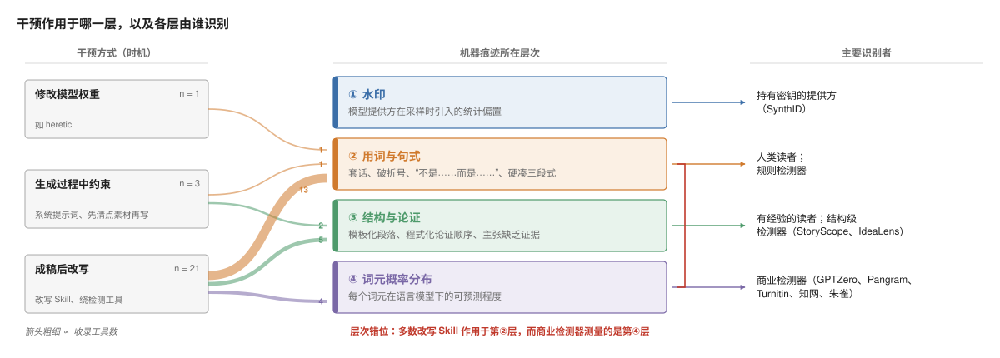

<!-- Generated by scripts/build_readme.py from data/ and templates/. Do not edit by hand. -->
# Awesome De-AI Writing｜去 AI 味工具综述

***本 GitHub repo 包含了 21 个 >1000 star 的去 AI 味 Skill。***

[English](README.md) · 星数截至 2026-11-22，每周自动更新

**图 1｜去 AI 味工具作用于哪一层，以及各层由谁识别。** 中间为文本可能携带机器痕迹的四个层次；左侧为按时机分组的干预方式，曲线粗细与作用于该层的收录工具数成正比；右侧为各层的主要识别者。红色标注示意层次错位：多数改写 Skill 作用于第②层，而商业检测器测量的是第④层。

## 表 1｜按原理分类

| 层次 | 原理 | Repo（⭐） | 做法差异 | 能否通过商业检测器 |
|---|---|---|---|---|
| **① 水印** | 生成时在采样中嵌入统计信号，由厂商凭密钥检测 | 文本类暂无；≥1k⭐ 的去水印工具均针对图像、视频或音频 | 大幅改写本身即可消除文本水印，因而没有专门工具 | — |
| **② 用词与句式（规则清单）** | 按「AI 痕迹清单」检查用词、标点与句式，再行改写 | [humanizer](https://github.com/blader/humanizer) 72.3k · [Humanizer-zh](https://github.com/op7418/Humanizer-zh) 23.6k · [stop-slop](https://github.com/hardikpandya/stop-slop) 19.1k · [no-ai-slop](https://github.com/petergyang/no-ai-slop) 13.7k · [im-not-ai](https://github.com/epoko77-ai/im-not-ai) 6.7k · [avoid-ai-writing](https://github.com/conorbronsdon/avoid-ai-writing) 6.0k · [说人话](https://github.com/MrGeDiao/shuorenhua) 2.7k · [SlopMonster](https://github.com/ItsssssJack/SlopMonster) 1.3k · [ai-flavor-remover](https://github.com/hylarucoder/ai-flavor-remover) 1.2k · [unslop](https://github.com/theclaymethod/unslop) 1.2k · [speak-human-tw](https://github.com/Raymondhou0917/speak-human-tw) 1.2k · [textlint-rule-preset-ai-writing](https://github.com/textlint-ja/textlint-rule-preset-ai-writing) 1.2k | 差异主要在清单来源：humanizer 系源自 Wikipedia 编辑的总结；stop-slop 规则最严（禁副词、禁被动）；说人话最保守；avoid-ai-writing 与 textlint 将清单做成可打分的检测器；SlopMonster 换用另一模型改写 | 否。规则检测分可降至零，商业检测器仍判为 AI |
| **②→③ 语料校准** | 先以语料统计哪些特征真正影响阅读，再决定改什么 | [lieflat-less-ai-tone](https://github.com/larashero3-dotcom/lieflat-less-ai-tone) 8.6k | 约 520 万字语料、100 余项指标；先出诊断报告，再改写并复测，涵盖由模型判断的语义层习惯 | 未宣称 |
| **③ 结构与论证** | 修改段落套路、论证顺序与叙事架构，或要求每句话都有素材和证据支撑 | [anti-defensive-writing-Skill](https://github.com/Adkid-Zephyr/anti-defensive-writing-Skill) 7.0k · [academic-humanizer](https://github.com/AIScientists-Dev/academic-humanizer) 5.9k · [human-writing](https://github.com/KKKKhazix/human-writing) 4.7k · [sepia](https://github.com/Nanako0129/sepia) 3.9k · [anti-defensive-writing](https://github.com/Kiterlin/anti-defensive-writing) 2.3k | sepia 先修叙事架构再动用词；human-writing 先清点素材、要求每段推进；academic-humanizer 检查主张与证据是否匹配；anti-defensive-writing 改的是叙事策略而非 AI 痕迹，可能删除不利结果 | 否或未测；改写者仍是 LLM |
| **④ 词元概率分布（降 AIGC）⚠️** | 让文本变得「不好猜」：回译、程序化替换、对照检测器反复改写 | [Turnitout-Humanizer](https://github.com/AhmadHassan-BTed/Turnitout-Humanizer) 12.5k · [humanize-text](https://github.com/lynote-ai/humanize-text) 3.5k · [AIWriteX](https://github.com/iniwap/AIWriteX) 2.3k · [BypassAIGC](https://github.com/chi111i/BypassAIGC) 2.3k | humanize-text 采用多引擎回译；其余均以通过 GPTZero、腾讯朱雀或 Turnitin 为卖点 | 宣称可以，未经验证。DAMAGE 研究审查的 19 个 humanizer 均降低了文本质量；用于提交的论文可能违反学术诚信规定 |
| **源头预防** | 在生成之前或生成过程中介入，而非事后改写 | [heretic](https://github.com/p-e-w/heretic) 42.6k · [writing-dna-skill](https://github.com/larashero3-dotcom/writing-dna-skill) 3.3k · [talk-normal](https://github.com/hexiecs/talk-normal) 1.9k | talk-normal 是一段系统提示词；heretic 修改开源模型权重以抑制 slop 与讨好倾向；writing-dna 蒸馏个人文风供模仿 | 未宣称 |

## 表 2｜按目的分类

| 目的 | 去 AI 味 Skill（⭐） | 相关写作套件（⭐） | 选用建议 |
|---|---|---|---|
| **科研论文与基金申请书** | [anti-defensive-writing-Skill](https://github.com/Adkid-Zephyr/anti-defensive-writing-Skill) 7.0k · [academic-humanizer](https://github.com/AIScientists-Dev/academic-humanizer) 5.9k · [anti-defensive-writing](https://github.com/Kiterlin/anti-defensive-writing) 2.3k | [gpt_academic](https://github.com/binary-husky/gpt_academic) 71.7k · [academic-research-skills](https://github.com/Imbad0202/academic-research-skills) 58.1k · [Research-Paper-Writing-Skills](https://github.com/Master-cai/Research-Paper-Writing-Skills) 8.5k | academic-humanizer 保留全部数字与引用，并标出超出证据的主张。科研文本不宜用 stop-slop（禁用被动语态）；使用 anti-defensive-writing 后须核对是否删去了不利结果 |
| **通用英文写作** | [humanizer](https://github.com/blader/humanizer) 72.3k · [stop-slop](https://github.com/hardikpandya/stop-slop) 19.1k · [no-ai-slop](https://github.com/petergyang/no-ai-slop) 13.7k · [avoid-ai-writing](https://github.com/conorbronsdon/avoid-ai-writing) 6.0k · [说人话](https://github.com/MrGeDiao/shuorenhua) 2.7k · [SlopMonster](https://github.com/ItsssssJack/SlopMonster) 1.3k · [unslop](https://github.com/theclaymethod/unslop) 1.2k | — | 全面修改用 humanizer；轻度修改用 no-ai-slop；需要前后对比打分时用 avoid-ai-writing |
| **简体中文写作** | [Humanizer-zh](https://github.com/op7418/Humanizer-zh) 23.6k · [lieflat-less-ai-tone](https://github.com/larashero3-dotcom/lieflat-less-ai-tone) 8.6k · [human-writing](https://github.com/KKKKhazix/human-writing) 4.7k · [说人话](https://github.com/MrGeDiao/shuorenhua) 2.7k · [ai-flavor-remover](https://github.com/hylarucoder/ai-flavor-remover) 1.2k | — | 全面修改用 Humanizer-zh；轻改用说人话；想先看诊断报告用 lieflat-less-ai-tone |
| **繁体中文、日语、韩语** | [im-not-ai](https://github.com/epoko77-ai/im-not-ai) 6.7k · [speak-human-tw](https://github.com/Raymondhou0917/speak-human-tw) 1.2k · [textlint-rule-preset-ai-writing](https://github.com/textlint-ja/textlint-rule-preset-ai-writing) 1.2k | — | 各语言专属痕迹清单；textlint 以确定性 lint 运行，无需 LLM |
| **小说与叙事** | [sepia](https://github.com/Nanako0129/sepia) 3.9k | [oh-story-claudecode](https://github.com/zenstory-ai/oh-story-claudecode) 8.8k · [Pagekin](https://github.com/EthanYoQ/Pagekin) 2.8k | sepia 修复叙事结构，而 StoryScope 等结构级检测器读取的正是这一层 |
| **社交媒体与公众号** | [human-writing](https://github.com/KKKKhazix/human-writing) 4.7k · [SlopMonster](https://github.com/ItsssssJack/SlopMonster) 1.3k | — | human-writing 缺素材时询问而不编造；SlopMonster 用第二个模型交叉清洗 |
| **技术文档** | [sepia](https://github.com/Nanako0129/sepia) 3.9k · [textlint-rule-preset-ai-writing](https://github.com/textlint-ja/textlint-rule-preset-ai-writing) 1.2k | [Tech-Doc-Style-Chinese](https://github.com/Fenng/Tech-Doc-Style-Chinese) 1.6k | 先用对应文体的写作 Skill，再叠加去 AI 味规则 |
| **降 AIGC 率 ⚠️** | [Turnitout-Humanizer](https://github.com/AhmadHassan-BTed/Turnitout-Humanizer) 12.5k · [humanize-text](https://github.com/lynote-ai/humanize-text) 3.5k · [AIWriteX](https://github.com/iniwap/AIWriteX) 2.3k · [BypassAIGC](https://github.com/chi111i/BypassAIGC) 2.3k | — | 出于完整性列出，不予推荐。效果未经验证，且此类改写会降低文本质量；请按投稿方要求披露 AI 使用 |

⚠️ 以绕过检测为卖点的工具，效果均为作者自述、未经验证，列出仅为完整起见，不予推荐。无论使用哪种工具，改写后均须逐一核对数字与结论，并按投稿方要求披露 AI 使用。

## 参与贡献

如需新增或修改条目，请编辑 [data/entries.yaml](data/entries.yaml)（表格行的文字说明见 [data/tables.yaml](data/tables.yaml)），运行 `python scripts/build_readme.py`，然后提交 pull request。收录标准与分层方法见 [CONTRIBUTING.md](CONTRIBUTING.md)。

## 许可

[CC0 1.0](LICENSE)。所链接项目沿用各自的许可协议。
